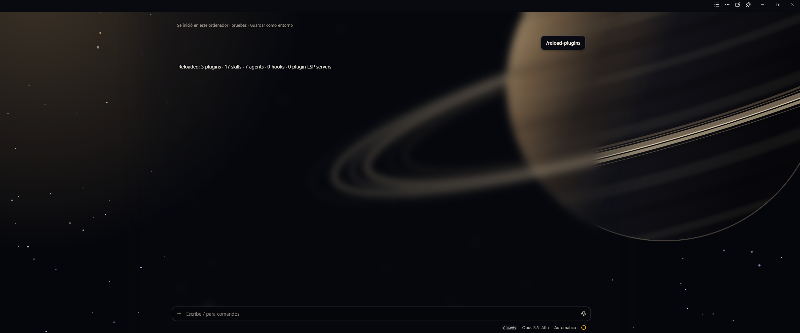
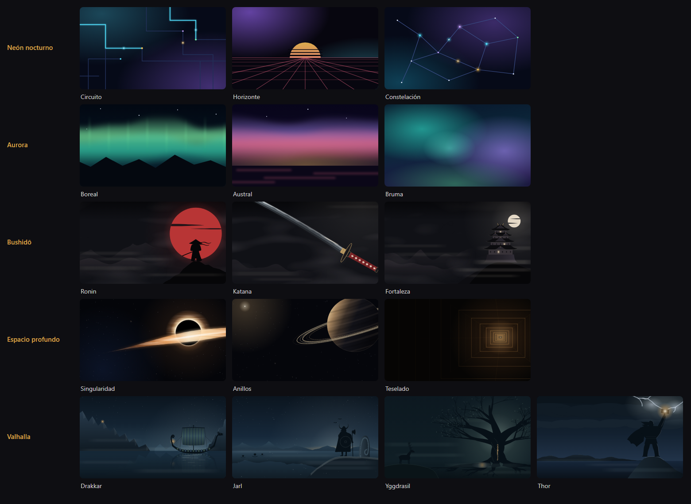
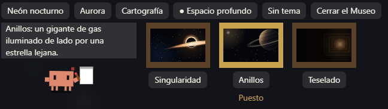
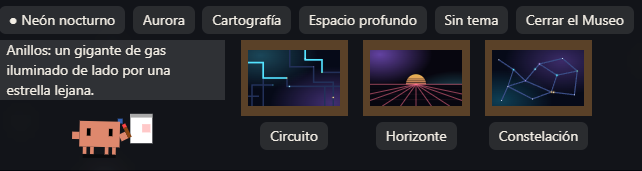

# museo-clawd

Mod de Claude Code que pone temas en la aplicación de escritorio. Cada tema hace tres cosas:

- **Los colores:** pinta los colores de la propia aplicación (paneles, tarjetas, menús, texto, acentos y código).
- **El fondo:** pone una escena que se mueve despacio detrás de la conversación, con los paneles de cristal encima.
- **El indicador:** lleva un motivo animado junto a la línea que dice qué está haciendo Claude.

Los temas se eligen en el Museo, un panel encima de la caja de texto con una sala por familia y un cuadro por tema. Lo guía un Clawd pintor que cuenta cómo es el tema que acabas de poner.

Es un proyecto de la comunidad, sin relación con Anthropic. Clawd es la mascota de Claude.

<p align="center">
  
</p>

## Los temas

Son dieciséis, en cinco salas, y todos son para el modo oscuro.

<p align="center">
  
</p>

| Sala | Tema | Cómo es | Qué se mueve |
| --- | --- | --- | --- |
| Neón nocturno | Circuito | Pistas de circuito en ángulo recto, sobre azul marino. | Impulsos de luz que recorren las pistas y nodos que laten. |
| Neón nocturno | Horizonte | Un sol a rayas sobre una cuadrícula rosa en perspectiva. | La cuadrícula avanza hacia ti y el sol late. |
| Neón nocturno | Constelación | Nodos que brillan unidos por hilos, como una red. | Señales que viajan por los hilos y nodos que laten. |
| Aurora | Boreal | Cortinas de aurora verdes sobre unas montañas. | Unas ondas recorren las cortinas, y los rayos fluyen de lado y laten. |
| Aurora | Austral | Cortinas rosa y lila sobre el mar, con su reflejo. | Las cortinas se mecen y el reflejo tiembla en el agua. |
| Aurora | Bruma | Luces suaves de turquesa, lila y verde. | Las luces derivan, crecen o menguan y laten, y una luz pequeña las cruza. |
| Bushidō | Ronin | Un guerrero solitario de espaldas, sobre una peña, ante un sol rojo enorme. | El viento mueve las cintas del sombrero, el bajo de la hakama, las nubes y la niebla. |
| Bushidō | Katana | Una espada en primer plano que cruza la noche en diagonal, con su empuñadura carmesí. | De vez en cuando, un destello recorre la hoja, y la niebla va y viene. |
| Bushidō | Fortaleza | Un castillo japonés sobre una colina, con sus tejados superpuestos, niebla y luna. | La niebla barre la colina, dos nubes cruzan la luna y las ventanas encendidas tiemblan como candiles. |
| Espacio profundo | Singularidad | Un agujero negro con la luz curvada a su alrededor y su disco de luz ámbar. | La luz corre por el disco y por el arco de arriba. |
| Espacio profundo | Anillos | Un planeta gigante con anillos, iluminado de lado por una estrella lejana. | Los anillos giran despacio y las estrellas titilan. |
| Espacio profundo | Teselado | Marcos de luz ámbar que se pierden en la distancia. | El corredor de marcos avanza hacia ti sin acabarse. |
| Valhalla | Drakkar | Un barco vikingo de vela cuadrada entre las paredes de un fiordo, con su proa de dragón. | El barco se mece, la vela se hincha, el agua tiembla con sus reflejos y los faroles parpadean. |
| Valhalla | Jarl | Un guerrero nórdico de espaldas en una cresta nevada, con el escudo redondo, el hacha y el casco con cuernos, junto a una piedra rúnica, mirando el fiordo al amanecer. | La capa ondea con las ráfagas, cae la nieve, dos cuervos dan vueltas y unos drakkares diminutos salen del fiordo. |
| Valhalla | Yggdrasil | El árbol del mundo, con el tronco retorcido y las raíces entrelazadas alrededor de un pozo de luz, y un ciervo que lo mira desde una loma. | Las runas del tronco despiertan una tras otra, suben motas de luz del pozo, la copa se mece y el ciervo mueve la cabeza. |
| Valhalla | Thor | El dios del trueno en lo alto de un risco, de frente, con el martillo en alto y la capa al viento, en una tormenta sobre el mar. | Los rayos caen en diagonal sobre el martillo, que se enciende, y en el cielo de la izquierda; la capa, el pelo y las nubes se mueven con el viento. |

En todos, el centro de la escena queda despejado, porque ahí va la conversación, y el movimiento es lento.

## Cómo se usa

<p align="center">
  
  <br>
  
</p>

- `/tema` abre el Museo encima de la caja de texto, en la sala del tema que tengas puesto. Los botones de arriba cambian de sala, la placa de cada cuadro pone ese tema, «Sin tema» lo quita y «Cerrar el Museo» lo cierra. El tema puesto lleva el marco dorado y la palabra «Puesto».
- `/tema circuito`, o el nombre de cualquier otro tema, con o sin tildes, lo pone directamente.
- `/tema no` quita el tema y deja la aplicación con su aspecto.
- `/tema lista` dice los temas de cada sala.

El tema que elijas se guarda y vale para todas tus sesiones, también las que abras después.

## Lo que hace falta

- **La aplicación de escritorio de Claude, en una versión que dibuje temas.** Si la tuya no los dibuja, el Clawd del Museo lo dice con el motivo que da la aplicación. La aplicación del móvil dibuja el fondo y los colores, pero no el Museo. La terminal y los editores no dibujan temas.
- **El movimiento:** la aplicación de escritorio mueve las escenas con sus animaciones. Si en el sistema tienes activada la opción de reducir el movimiento (en Windows, con los efectos de animación desactivados), las escenas se quedan quietas, y están pensadas para quedar bien también así.
- **Un tema a la vez:** solo puede haber un tema y gana el último que se pone, así que conviene no tener a la vez otro mod de temas.

## Instalación

Hay tres formas de instalarlo, según dónde uses Claude Code. Elige una sola, porque las tres hacen lo mismo. No hace falta cuenta de GitHub.

**En la app de escritorio**, donde `/plugin` no funciona: pulsa el botón + junto al cuadro de texto, después **Plugins**, **Add marketplace** con `CristianInBits/museo-clawd`, y luego **Add plugin**.

**En una sesión de Claude Code en la terminal**, escribe en el cuadro de la conversación:

```
/plugin install museo-clawd --marketplace CristianInBits/museo-clawd
```

**En una terminal normal**, como PowerShell en Windows o Terminal en Mac:

```
claude plugin install museo-clawd --marketplace CristianInBits/museo-clawd
```

Después, escribe `/tema` en una sesión de la app de escritorio para abrir el Museo.

## Actualizar

Cuando haya una versión nueva, ejecuta estas dos órdenes en una terminal normal, una detrás de otra y en este orden:

```
claude plugin marketplace update museo-clawd
```

```
claude plugin update museo-clawd@museo-clawd
```

Después escribe `/reload-plugins` en una sesión abierta, o abre una sesión nueva.

## De dónde salen los dibujos

Los dibujos son propios. Los de Neón nocturno y Aurora están escritos a mano, y los de Bushidō, Espacio profundo y Valhalla los calculan los generadores de `herramientas/` (ver `herramientas/LEEME.md`). Bushidō toma el espíritu de los grabados japoneses: siluetas planas, pocos elementos, bandas de niebla y negro, carmesí y pergamino. Espacio profundo toma el espíritu de la ciencia ficción del espacio: luz ámbar contra el negro y una escala enorme. Valhalla toma el de las sagas nórdicas: fiordos, barcos de madera, montañas escarpadas, guerreros y piedras rúnicas, sin fantasía exagerada.

## Licencia

MIT, ver `LICENSE`. El dibujo del Clawd pintor viene de [clawd-pet](https://github.com/abderrahimghazali/clawd-pet), de Abderrahim Ghazali, con licencia MIT (ver `LICENSE-clawd-pet.txt`).

El sistema de mods de Claude Code está en fase de pruebas y puede cambiar entre versiones.
